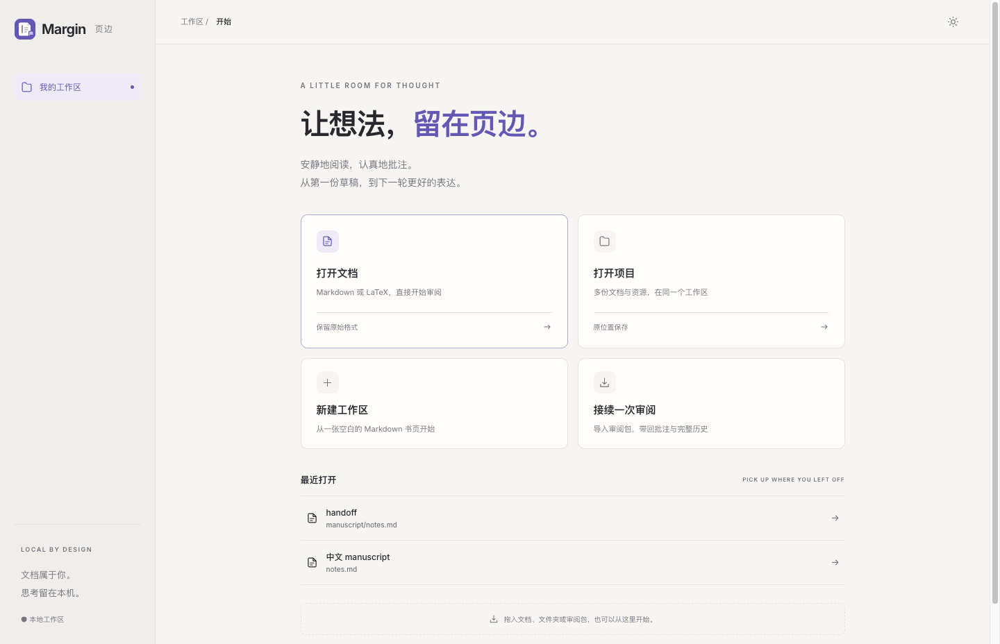

<p align="center">
  
</p>
<h1 align="center">Margin · 页边</h1>
<p align="center"><strong>A little room for thought.</strong><br>Read closely. Leave a note. Make the next draft better.</p>
<p align="center">
  <a href="https://github.com/Becomingw/Margin/releases/tag/v0.1.0">Download v0.1.0</a> ·
  <a href="README.zh-CN.md">简体中文</a> ·
  <a href="#quick-start">Quick start</a> ·
  <a href="https://github.com/Becomingw/Margin/issues">Feedback</a>
</p>
<p align="center"><code>Markdown + LaTeX</code> &nbsp; <code>Local-first</code> &nbsp; <code>Manual review</code> &nbsp; <code>MIT</code></p>

<picture>
  <source media="(prefers-color-scheme: dark)" srcset="docs/images/review-markdown-dark.png">
  
</picture>

**Margin is an independent, local workspace for reviewing Markdown and LaTeX.**
Keep your manuscript in its original format, put feedback beside the text, and
carry the complete review history into the next round. No account, cloud service,
model or API key is needed. There is no built-in AI execution.

## A calmer review loop

| Read | Review | Revise | Hand off |
| --- | --- | --- | --- |
| Open `.md`, `.tex` or a whole project. Navigate headings and rendered math. | Comment on a selection, block or document. Reply, resolve and reopen. | Edit original source, record your reason, compare versions and restore earlier text. | Export a portable review package. Import elsewhere and continue with the same IDs and history. |

- **Your source stays yours.** Comments live in separate review state, never injected into manuscript markup. Source changes require an explicit author action.
- **Every round stays connected.** Saved revisions, replies, comment edits and status changes remain in the history. A new review baseline does not erase the past.
- **Built for sustained reading.** Warm paper, quiet navigation, a focused inspector, light/dark themes and a responsive layout.
- **A native starting point.** Desktop file dialogs, drag-and-drop, recent projects and persistent imported workspaces. Installed apps bundle Node.

## Download

| Platform | v0.1.0 installer |
| --- | --- |
| macOS · Apple Silicon | [DMG](https://github.com/Becomingw/Margin/releases/download/v0.1.0/Margin-0.1.0-mac-arm64.dmg) |
| macOS · Intel | [DMG](https://github.com/Becomingw/Margin/releases/download/v0.1.0/Margin-0.1.0-mac-x64.dmg) |
| Windows · x64 | [Installer](https://github.com/Becomingw/Margin/releases/download/v0.1.0/Margin-0.1.0-win-x64.exe) |

macOS ZIPs and SHA-256 checksums are available on the [release page](https://github.com/Becomingw/Margin/releases/tag/v0.1.0).
**v0.1.0 builds are unsigned; macOS builds are not notarized.** The operating system
may display an unidentified-publisher warning. On macOS, drag Margin to Applications;
on Windows, run the per-user installer. LaTeX tools are optional and not bundled.

<details>
<summary><strong>A place to start — desktop workspace</strong></summary>
<br>
<picture>
  <source media="(prefers-color-scheme: dark)" srcset="docs/images/desktop-home-dark.png">
  
</picture>
</details>

## Quick start

For running from source, install **Node.js 20+**:

```sh
git clone https://github.com/Becomingw/Margin.git
cd Margin
npm ci
npm run desktop
```

Prefer your browser? Run `npm run demo` and open the printed local URL. The demo
uses a disposable fictional manuscript; stopping it removes the copy.

To review your own document in the browser:

```sh
npm run setup -- /path/to/document-or-project --no-compile --json
npm run doctor -- --json
npm start
```

Either `.md` or `.tex` works. For a multi-file project, add `--main main.tex` or
`--main notes.md`. Setup creates `.margin.json` and private `.margin/` state next
to the manuscript. **Opening edits in place; importing creates a separate copy.**

## From one draft to the next

1. **Open and read.** Choose your document and use the outline to move through it.
2. **Leave feedback.** Select a passage to comment, or add a document-wide note.
3. **Make a deliberate edit.** Save source changes with a reason and optionally link a comment.
4. **Compare.** Switch between current text, source-level changes and the review-round original.
5. **Pass it on.** Export a review package, restore it in another workspace and keep reviewing.

<details>
<summary><strong>LaTeX is a first-class document format</strong></summary>
<br>
<picture>
  <source media="(prefers-color-scheme: dark)" srcset="docs/images/review-latex-dark.png">
  
</picture>
</details>

### A review you can carry

A `.marginreview` / ZIP package contains original and current sources, supported
resources, a readable `REVIEW.md`, and structured comments, revisions and events.
`review/state.json` is the complete restoration record. IDs survive import.

Give the package to a collaborator or an external agent without requiring them to
use Margin to read the feedback. Import restores a complete snapshot; changing
`REVIEW.md` alone is not a patch protocol. Duplicate identities are rejected rather
than silently merged. Packages include **deleted comments and earlier versions**.

## Scope of v0.1

- Markdown supports common structures and math with source-preserving mapping; it is not a full CommonMark/HTML renderer. Unknown syntax stays visible.
- LaTeX is a source-based reading view, not a typeset PDF editor. Optional local PDF compilation is available through the API, outside the review toolbar.
- Non-UTF-8 files remain read-only. Review packages are limited to **32 MiB** both compressed and expanded.
- Legacy AI adapters remain for compatibility; model-execution routes return **410**. Existing review data has [migration support](docs/migration.md).

## Development & documentation

```sh
npm test                         # syntax, portable smoke, Node test suites
npx playwright install chromium # one-time browser installation
npm run screenshots              # browser regression + fictional screenshots
npm run test:desktop             # real Electron smoke test
```

Plain DOM, ES modules and a local Node server. KaTeX is the sole runtime library;
Electron and Playwright are development/distribution tools. No frontend build step.

| Guide | Reference |
| --- | --- |
| [Configuration](docs/configuration.md) | [HTTP API](docs/api.md) |
| [Desktop builds](docs/desktop-packaging.md) | [Review package format](docs/review-package.md) |
| [Agent installation](docs/INSTALL-FOR-AGENTS.md) | [LaTeX conventions](docs/latex-conventions.md) |
| [Design system](DESIGN.md) | [Security](SECURITY.md) |
| [Contributing](CONTRIBUTING.md) | [Changelog](CHANGELOG.md) |

---

<p align="center">Made for the space between reading and rewriting.<br><a href="LICENSE">MIT License</a> · <a href="NOTICE.md">Source attribution</a> · <a href="THIRD_PARTY.md">Third-party notices</a></p>
