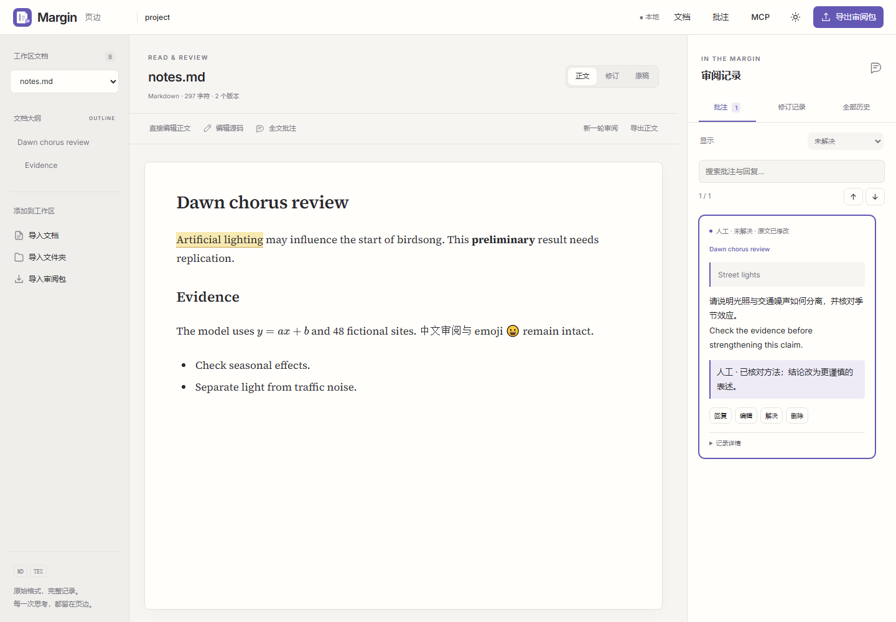
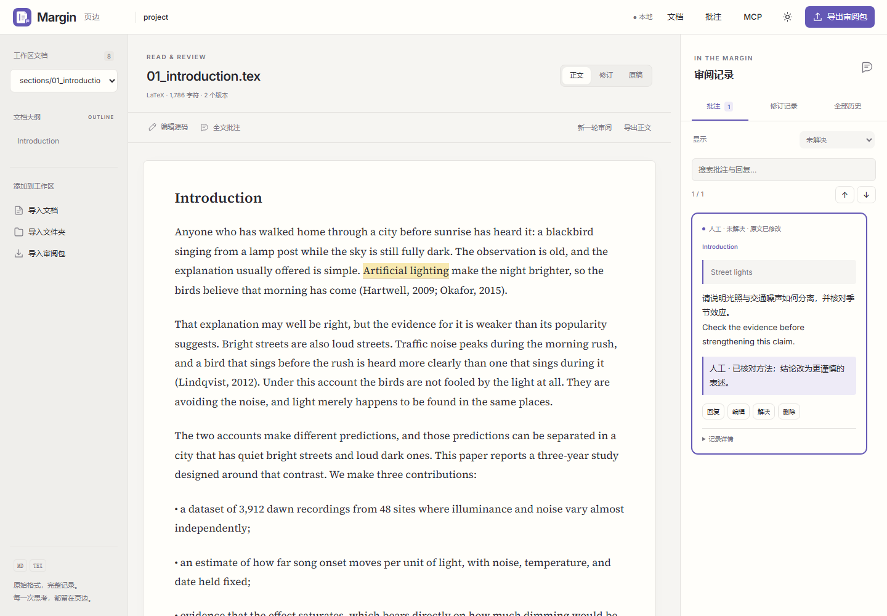
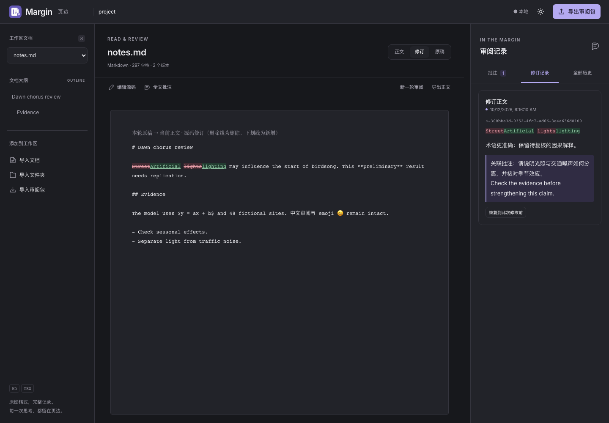

<h1 align="center">Margin · 页边</h1>

<strong>让想法，留在页边。</strong> 读懂一段文字，留下一条意见，把下一稿改得更好。

  <a href="#下载与开始">下载使用</a> ·
  <a href="#从阅读到交接">功能介绍</a> ·
  <a href="README.md">English</a> ·
  <a href="https://github.com/Becomingw/Margin/issues">反馈建议</a>

<code>Markdown + LaTeX</code> &nbsp; <code>本地审阅</code> &nbsp; <code>完整历史</code> &nbsp; <code>自由交接</code>

<picture>
  <source media="(prefers-color-scheme: dark)" srcset="docs/images/review-markdown-dark.png">
  
</picture>

正文在中间，思考在页边。浅色与深色主题，陪你读完每一稿。

**Margin 是面向 Markdown 与 LaTeX 的本地文档审阅工作区。**
从论文初稿到技术文档，把阅读、批注、修改和版本回顾放在一起。
正文保留原始格式，审阅记录独立保存；无需账号或云服务，也不需要配置 AI。

## 从阅读到交接

### 阅读，专注于文字本身

打开一份文档，或把整个多文件项目带进工作区。通过章节大纲快速定位，
在阅读视图中查看正文与公式，再随时进入源码编辑。

- **两种格式，同一种习惯**：Markdown 与 LaTeX 都能阅读、批注、修订和导出。
- **长文也有方向**：文档切换与章节导航，让你在不同部分之间来回核对。
- **让界面退后一点**：暖白纸面、克制的工具栏、深色主题与窄屏布局，为正文留出空间。

<strong>查看 LaTeX 审阅界面</strong>

 
<picture>
  <source media="(prefers-color-scheme: dark)" srcset="docs/images/review-latex-dark.png">
  
</picture>

### 批注，让每条意见有所指

选中一句话留下具体建议，对整段文字讨论论证，也可以用全文批注记录总体意见。
反馈与对应原文关联，正文保持干净，不必在源码中穿插审阅标记。

| 你想做的事 | Margin 如何帮助你 |
| --- | --- |
| 指出一句话的问题 | 选区批注保留引用内容，方便回到原文核对。 |
| 把意见讨论清楚 | 在批注下回复，让补充说明留在同一条讨论中。 |
| 跟进处理进度 | 筛选未解决意见，解决后关闭，需要时重新打开。 |
| 回顾曾经的反馈 | 编辑、删除与恢复批注都有历史可查。 |

### 修订，看见变化，也记住原因

从局部替换到全文源码编辑，按需要选择修改范围。保存时可以填写修改理由、
关联对应批注，把「改了什么」与「为什么改」留在一起。

- **正文 / 修订 / 原稿**：查看当前内容、源码级差异和本轮审阅的起点。
- **版本可以回头看**：恢复旧稿会形成新修订，已有记录仍然保留。
- **新一轮，不是重新来过**：更新比较基线，继续审阅，同时保留之前的修改与讨论。

<strong>查看原稿与修订对比</strong>

 

### 交接，把上下文一起带走

导出一份审阅包，交给合作者，或在另一台电脑上继续。
重新导入后，正文、批注、回复、版本和历史仍然关联，可以接着编辑，再交给下一位。

> **带走的不只是最后一稿，还有走到这一稿的过程。**

审阅包包含原稿、当前正文、支持的资源文件，以及便于阅读的 `REVIEW.md` 和结构化记录。
协作者或外部 Agent 无需运行 Margin，也能阅读其中的反馈。只需要正文时，也可以单独导出当前文档。

### 本地工作区，打开就能开始

原生文件选择、拖放、最近项目，让开始与接续审阅都更直接。
新建和导入的工作区保存在本机，应用重启后仍可继续；切换文档或退出时，会提醒尚未保存的编辑。

**打开项目在原位置编辑；导入创建独立副本。** 你可以选择继续修改自己的稿件，
也可以把收到的文档或审阅包单独保存。

## 适合这些时刻

| 场景 | 用法 |
| --- | --- |
| 论文自查 | 通读一轮，用批注标出论证与表达问题，再逐项修订。 |
| 导师或合作者审阅 | 交换完整审阅包，让意见、回复与修改理由一起传递。 |
| 技术文档打磨 | 在 Markdown 原始格式中修改，回看每一轮的差异。 |
| 外部 Agent 辅助修改 | 提供审阅包中的正文与反馈，作为外部工具理解修改需求的上下文。 |

## 下载与开始

| 平台 | v0.1.0 安装包 |
| --- | --- |
| macOS · Apple Silicon | [下载 DMG](https://github.com/Becomingw/Margin/releases/download/v0.1.0/Margin-0.1.0-mac-arm64.dmg) |
| macOS · Intel | [下载 DMG](https://github.com/Becomingw/Margin/releases/download/v0.1.0/Margin-0.1.0-mac-x64.dmg) |
| Windows · x64 | [下载安装程序](https://github.com/Becomingw/Margin/releases/download/v0.1.0/Margin-0.1.0-win-x64.exe) |

1. **安装 Margin**：macOS 拖入「应用程序」；Windows 运行安装程序。无需另外安装 Node。
2. **打开文档或项目**：选择 `.md`、`.tex` 或文件夹，也可以拖入，或导入收到的审阅包。
3. **开始第一条批注**：选中文字留下意见，修改后保存，再通过修订视图回看变化。

macOS ZIP、校验和及验证范围见[发布页](https://github.com/Becomingw/Margin/releases/tag/v0.1.0)。
当前安装包未签名，macOS 未公证，系统可能显示开发者身份提示。

<strong>使用前了解这几件事</strong>

- Margin 专注人工审阅，没有内置 AI 执行功能，也不需要模型或 API Key。
- Markdown 支持常见结构与公式，并非完整 HTML 渲染器；LaTeX 是源码阅读视图，不是排版 PDF 编辑器。
- 非 UTF-8 文件只读。审阅包压缩前后均限 32 MiB，并包含历史版本与已删除批注。
- 审阅包用于完整恢复，不自动合并相同 ID 的分支；单独修改 `REVIEW.md` 不会成为可导入的修改补丁。
- 本地浏览器版与源码运行见[安装指南](docs/INSTALL-FOR-AGENTS.md)；旧数据见[迁移说明](docs/migration.md)。

## 致谢

Margin 基于 [Paper Pal](https://github.com/claire1217/paper-pal) 发展而来。
感谢 [claire1217](https://github.com/claire1217) 及原项目贡献者开源这份工作，
为本地文档审阅、LaTeX 阅读与作者掌控修改的工作方式打下基础。

在这一基础上，Margin 将方向聚焦于 **Markdown / LaTeX 双格式人工审阅与完整历史交接**，
并以独立品牌、界面和桌面应用继续发展。也感谢
[awesome-design-md](https://github.com/VoltAgent/awesome-design-md) 提供的设计参考。
原项目的 MIT 版权与许可声明保留在 [LICENSE](LICENSE) 和 [NOTICE.md](NOTICE.md) 中。

---

在阅读与重写之间，留一点思考的空间。 <a href="CHANGELOG.md">更新记录</a> · <a href="CONTRIBUTING.md">参与贡献</a> · <a href="docs/configuration.md">使用配置</a> · <a href="LICENSE">MIT 许可证</a> · <a href="THIRD_PARTY.md">第三方许可</a>

